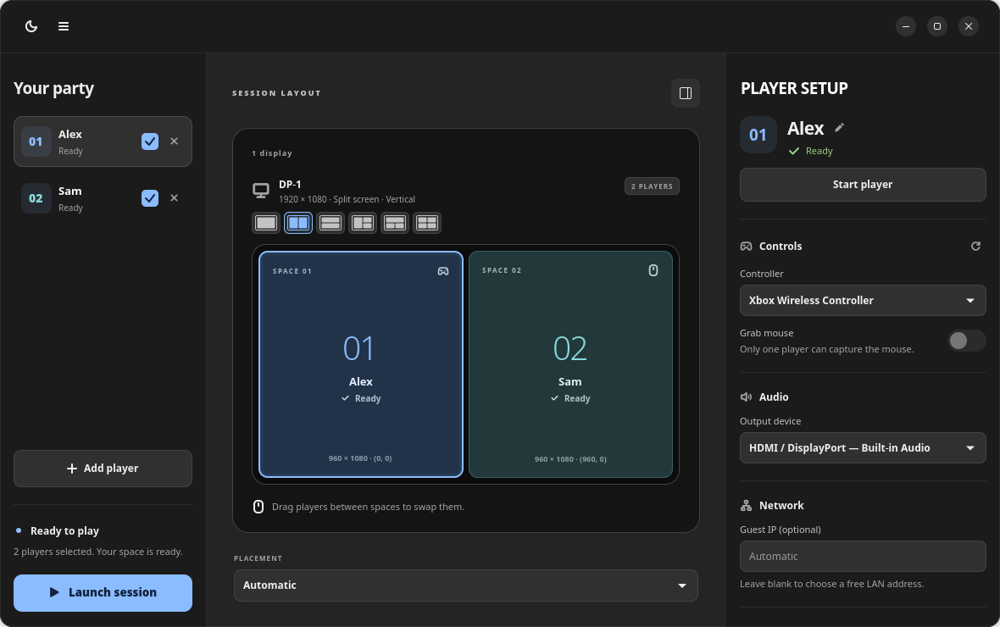

<p align="right">
  <a href="https://mall0r.github.io/Twinverse/"></a>
  <a href="README.md"></a>
  <a href="docs/README.pt-br.md"></a>
</p>

<p align="center">
  
</p>

<p align="center">
  <a href="https://github.com/mall0r/Twinverse/releases"></a>
  <a href="https://mall0r.github.io/Twinverse/"></a>
  <a href="LICENSE"></a>
  <a href="https://www.gtk.org/"></a>
  <a href="https://gnome.pages.gitlab.gnome.org/libadwaita/"></a>
</p>

<p align="center">
  <a href="https://www.python.org" target="_blank" rel="noopener noreferrer"></a>
  <a href="https://www.gnu.org/software/bash/" target="_blank" rel="noopener noreferrer"></a>
  <a href="https://www.javascript.com/" target="_blank" rel="noopener noreferrer"></a>
  <a href="https://www.w3.org/Style/CSS/" target="_blank" rel="noopener noreferrer"></a>
</p>

# What is Twinverse?

**Twinverse** is an open-source desktop application for Linux and SteamOS that lets you create and manage up to **8 isolated `Steam Big Picture` instances** simultaneously. Multiple players can enjoy their game libraries on a single computer—in splitscreen or across multiple monitors—with dedicated controllers, audio outputs, home directories, and private LAN IPv4 addresses.

> [!TIP]
> **Full Interactive Documentation:** Visit the [**Twinverse Documentation Site**](https://mall0r.github.io/Twinverse/) (English & Português BR) for the complete illustrated step-by-step guide, visual layout diagrams, all features, shortcuts, and troubleshooting FAQ.

<p align="center">
  
</p>

> [!WARNING]
> This project does not support piracy; all players must own (or have legitimate access to) the game in their Steam libraries to play it.

## ✨ Key Features

> [!NOTE]
> Mouse and keyboard (`Grab mouse`) can only be assigned to one instance at a time.

1. **Up to 8 Isolated Instances:** Run multiple Steam clients simultaneously with custom editable player names, per-player inclusion toggles, and automatic crash/session recovery.
2. **Per-Monitor Tiling & Drag-and-Drop Studio:** Choose from 6 visual templates per display (`Fullscreen`, `Columns`, `Rows`, `Main left`, `Main top`, `Grid` — up to 4 players per monitor), mix templates across monitors, and drag players directly between spaces.
3. **True Input Isolation:** Masks `/dev/input` per sandbox so each player only sees their assigned controller (or an automatic `"Virtual Joystick by Twinverse"` when no physical controller is selected), plus one-time per-account Steam Input disabling.
4. **Dedicated Audio Outputs:** Route each player's audio to its own PipeWire/PulseAudio sink (`PULSE_SINK`) with per-instance PipeWire capture isolation.
5. **Rootless Per-Instance Networking (`pasta`):** Automatically assigns each instance its own free LAN IPv4 address (or an optional fixed `Guest IP`) so local co-op and dedicated servers connect directly without port conflicts or Steam relays.
6. **Dedicated Home Directories & Sandbox Shell:** Each player gets an isolated `home_1`–`home_8` directory with one-click access to open its folder, launch a sandboxed terminal inside the player's container, or reset the slot.
7. **Shared Game Library & Any Proton:** Bind-mounts your host `steamapps/common/` (with automatic `.acf` manifest sync) and `compatibilitytools.d/` (including [ProtonGE](https://github.com/GloriousEggroll/proton-ge-custom)), so games are never downloaded twice.
8. **Play Different Games Simultaneously:** Each instance is completely independent—players do not need to play the same title.
9. **KDE Plasma 6 / KWin Auto-Tiling:** Automatic borderless window placement via D-Bus instance resolution (`TWINVERSE_KWIN_INSTANCE`) and automatic Plasma panel dodging that restores when your session ends.

---

[1920x1080-RX_6600_XT-demo](https://github.com/user-attachments/assets/e0ca4937-fd38-48cf-b56c-1c825b047572)

---

## 📦 Requirements

You need the **native** host packages `steam`, `gamescope`, `bubblewrap` (`bwrap`), and `pactl` (`pipewire-pulse` or `pulseaudio-utils`) installed from your distribution.

- **Strongly recommended (`pasta` / `passt`):** Enables automatic rootless per-instance network isolation with distinct LAN IPv4 addresses. Install it on the host `PATH`, including when running Twinverse via Flatpak. See the [Networking section](https://mall0r.github.io/Twinverse/#feature-networking) or [Guide](docs/GUIDE.md#per-instance-networking-pasta).
- **Mandatory `input` group:** Add your user to the `input` group and reboot so Twinverse can manage controllers and virtual joysticks:

```bash
# Most Linux distributions
sudo usermod -aG input "$USER"

# Bazzite
ujust add-user-to-input-group
```

For Gamescope GPU support, you will need:

- **AMD:** Mesa 20.3 or newer
- **Intel:** Mesa 21.2 or newer
- **NVIDIA:** Proprietary drivers 515.43.04 or newer, or NVIDIA Open Kernel Module drivers

> [!NOTE]
> *SteamOS* (AMD) and *Bazzite* include Steam, Gamescope, Bubblewrap, and PipeWire by default.

## 📦 Installation

### Flatpak (Recommended)

1. Download the latest `Twinverse-*.flatpak` file from [**Releases**](https://github.com/mall0r/Twinverse/releases).
2. Add the Flathub remote (if not already configured) and install:

```bash
flatpak remote-add --user --if-not-exists flathub https://flathub.org/repo/flathub.flatpakrepo
flatpak install --user Twinverse-*.flatpak
```

### AppImage

> [!NOTE]
> Make sure the `bubblewrap` package is installed on your host.

1. Download the latest `Twinverse-*.AppImage` from [**Releases**](https://github.com/mall0r/Twinverse/releases).
2. Make it executable and run:

```bash
chmod +x Twinverse-*.AppImage
./Twinverse-*.AppImage
```

For menu integration and automatic updates, consider managing the AppImage with **[Gear Lever](https://github.com/mijorus/gearlever)**.

### Running from Source

```bash
git clone https://github.com/mall0r/Twinverse.git
cd Twinverse
./run.sh
```

## 📖 Documentation & Guides

- **Interactive Documentation (EN / PT-BR):** [https://mall0r.github.io/Twinverse/](https://mall0r.github.io/Twinverse/)
- **Step-by-Step Guide (Markdown):** [docs/GUIDE.md](docs/GUIDE.md) | [docs/GUIDE.pt-br.md](docs/GUIDE.pt-br.md)
- **Debugging & Logs:** [docs/DEBUGGING.md](docs/DEBUGGING.md) | [docs/DEBUGGING.pt-br.md](docs/DEBUGGING.pt-br.md)

---

## ⚙️ How It Works

Twinverse dynamically assembles a nested, rootless isolation stack for every player:

```text
[pasta (optional netns)] -> bwrap (sandbox) -> gamescope (compositor) -> Steam Big Picture
```

1. **`pasta`** (when installed) gives each instance an isolated network namespace with its own free LAN IPv4 address.
2. **`bwrap` (Bubblewrap)** mounts a dedicated `home_N` directory, masks `/dev/input` to expose only the player's controller, bind-mounts your shared `steamapps/common/` and `compatibilitytools.d/`, and sets `PULSE_SINK` and custom environment variables.
3. **`gamescope`** renders the player's Steam Big Picture session at the exact tile resolution and monitor refresh rate, handles exclusive cursor grabbing, and works with KWin's D-Bus resolver on KDE Plasma 6.0+ for automatic borderless tiling.

---

## 🛠️ For Developers

If you wish to contribute to Twinverse, please refer to [CONTRIBUTING.md](CONTRIBUTING.md) for setup instructions, workflows, and code standards.

---

## 📜 License

This project is licensed under the **GNU General Public License v3.0 (GPL-3.0-or-later)**. See [LICENSE](LICENSE) for details.

> [!NOTE]
> ## Legal Disclaimer
>
> Twinverse is an independent open-source project and is not affiliated with, endorsed by, or in any way officially connected to Valve Corporation or Steam.
>
> This tool acts as an orchestration layer that leverages sandboxing technologies to run multiple isolated instances of the official Steam client. Twinverse **does not modify, patch, reverse engineer, or alter** any Steam files or its normal operation. All Steam instances launched by this tool are the official, unmodified versions provided by Valve.
>
> Users are solely responsible for complying with the terms of the Steam Subscriber Agreement.

---

## 🙏 Credits

This project was inspired by the work of:

- [NaviVani-dev](https://github.com/NaviVani-dev) and their script [dualscope.sh](https://gist.github.com/NaviVani-dev/9a8a704a31313fd5ed5fa68babf7bc3a).
- [Tau5](https://github.com/Tau5) and their project [Co-op-on-Linux](https://github.com/Tau5/Co-op-on-Linux).
- [wunnr](https://github.com/wunnr) and their project [Partydeck](https://github.com/wunnr/partydeck) (recommended if you're looking for an approach closer to [Nucleus Co-op](https://github.com/SplitScreen-Me/splitscreenme-nucleus)).
