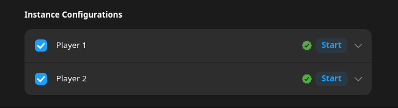
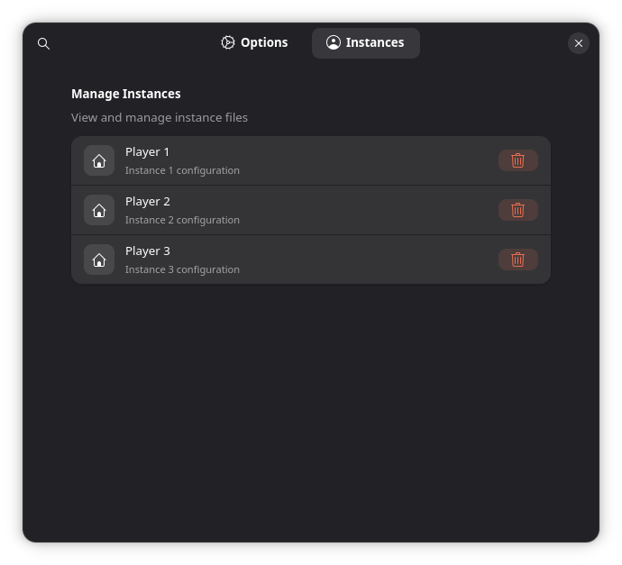

<p align="right">
  <a href="https://github.com/mall0r/Twinverse/blob/main/docs/GUIDE.md"></a>
  <a href="https://github.com/mall0r/Twinverse/blob/main/docs/GUIDE.pt-br.md"></a>
</p>

# Twinverse Guide

Welcome to the Twinverse guide! This document will walk you through the process of setting up and using the Twinverse application to run multiple Steam instances.

### Connection problems

If Steam Link or games have connection problems caused by multiple instances using the same ports, install `pasta` on your system (usually the `passt` package) and relaunch the instances. Twinverse detects it automatically and isolates each instance's network while providing internet access, without running as root. This also applies to the Flatpak version: `pasta` must be available on the host's `PATH`.

Each instance also receives its own free IPv4 address in the host's subnet. This matters when the game server runs on the same machine as the clients: without a distinct address, the guest and the server share the host address, and Steam may route the connection through a relay, adding latency. Twinverse picks an unused address automatically and never uses the host address. If you need a fixed address, fill in the "Guest IP" field of the instance; leave it empty to keep the automatic choice. Use addresses that are free on your network, and keep them different between instances.

Without `pasta`, networking works as before, sharing the host network between instances.

## 1. Number of Instances

First, you need to decide how many Steam instances you want to run. Twinverse supports up to 8 instances total.

- **Splitscreen:** You can run a maximum of 4 instances per monitor.
- **Fullscreen:** Each instance runs on its own monitor.

Use **Party size** in the left sidebar to set the desired amount, then check the players who should join. **Launch session** is at the bottom of that sidebar. The panel visibility buttons are beside the application menu on the left of the header.


## 2. Screen Mode

> [!NOTE]
> For window auto-tiling to work properly, it is recommended to use KDE Plasma 6.0+.
> In other DEs, you will need to move the windows yourself, everything else should work fine.

Choose a template using the six miniature layout icons beneath each monitor heading. Each monitor has its own selection:

- **Fullscreen:** one space covering the monitor.
- **Columns / Rows:** two spaces, side by side or stacked.
- **Main left / Main top:** three spaces, with a larger main area on the left or top.
- **Grid:** four equal spaces.

You can mix templates: for example, two players in columns on Monitor 1 and one fullscreen player on Monitor 2. The canvas previews the exact spaces; hovering an icon shows its name and capacity. Unused monitors also have their own selector.

Empty spaces remain available for dragging or selection in Player Setup. If the templates cannot fit every participating player, the extra players appear under **Players without a space**, and launching is blocked until you choose a larger template or exclude those players.

Templates and player assignments are saved per monitor connector. They determine Gamescope dimensions and refresh rates as well as KWin window positioning; existing profiles keep their previous arrangement until you choose a template.

#### Instance Placement

By default, instances fill the layout in numerical order. Change a player's position in either of two ways:

- **Drag and drop:** drag the player from the party sidebar or a canvas space onto another space, including one on another monitor. Hold near the top or bottom edge of the canvas to scroll through a long monitor layout.
- **Player Setup:** select the player and choose **Monitor / space** under **Display position**. The destination list corresponds to the spaces shown on the canvas.

Occupied spaces swap players, keeping each participating player assigned exactly once. The first move switches **Placement** to **Custom** automatically. Choose **Automatic** to restore numerical order without changing the monitor templates. Dragging and selection stay synchronized and are locked while any instance is starting, running or stopping. The saved order drives both Gamescope dimensions and KWin positioning.

Placement is applied on the next launch. Reducing the number of instances keeps the saved positions hidden, so they come back if you increase the count again.

## 3. Instance Configuration

> [!IMPORTANT]
> To use Twinverse, it's necessary to add your user to the `input` group to allow the program to manage input devices.
> ```bash
> sudo usermod -aG input $USER
> ```
> in the Bazzite:
> ```bash
> ujust add-user-to-input-group
> ```
> **Restart the system for the changes to take effect.**

For each instance, you can configure the following options:

- **Gamepad:** Assign a specific controller to the instance.
- **Grab Mouse:** Dedicate the mouse to a single instance. For now, only one instance at a time can use the mouse and keyboard.
- **Audio Device:** Select a specific audio output device for the instance.
- **Environment Variables:** Define specific environment variables for the instance.


## 4. Starting an Instance

After setting up an instance, click the **"Start"** button next to it to launch a Steam instance in desktop mode. The first time, the Steam Client will be downloaded and installed automatically — this process may take a few minutes.

You must log in to desktop mode. After logging in and configuring your Steam Client, simply close the instance.

The **"Play"** button runs all selected instances, and with a checkmark, it will run them all with the gamescope and resize each one.

If you are using KDE Plasma, it will also automatically move them to ideally split the screen for your main monitor, or move them between your monitors if you have selected fullscreen.

Only instances that already have Steam installed can be started with **"Play"**. You can verify this by the check icon  on the instance. If the icon is an , install Steam by clicking the **"Install"** button on that instance.



## 5. Disable Shader Pre-Caching (Optional)

To save disk space, disable shader pre-caching on Steam. I also recommend doing this if you have any problems with pre-caching downloads.

To do this, go to `Settings > Downloads` and disable the `Enable shader pre-caching` option.


## 6. Play

When all your instances are configured and running, you can start playing! Each instance will have its own dedicated input and audio devices, allowing you to play with your friends or family on the same computer.

Enjoy your gaming session!

# Tips

## 1. Multi-GPU Support

Twinverse works with games on different GPUs.

Add the following line to your game's Steam launch arguments:

```bash
DRI_PRIME=1
```

Or force it with:

```bash
DRI_PRIME=1!
```

You can adjust the numbers according to your system configuration.

> [!WARNING]
>
> This must be added directly to the game's launch arguments in the Steam instance where you want to use the GPU. Do not add this to the `Environment Variables`.

## 2. Home Directories

You can delete or manage the files in the home directory of each instance by accessing `Preferences` -> `Instances`.



## 3. Steam Input

Steam Input is not compatible with instances, so Twinverse turns it off inside each instance: on the first launch that already finds a logged-in account, it disables the controller toggle and every game of the instance library. On a brand-new instance this happens on the launch right after you log in.

It runs only once per instance. Anything you change afterwards is kept, and your own Steam client outside Twinverse is never touched.

## 4. Gamescope Keyboard shortcuts:
```
Super + F      Toggle fullscreen
```
```
Super + N      Toggle nearest neighbour filtering
```
```
Super + U      Toggle FSR upscaling
```
```
Super + Y      Toggle NIS upscaling
```
```
Super + I      Increase FSR sharpness by 1
```
```
Super + O      Decrease FSR sharpness by 1
```
```
Super + S      Take a screenshot
```
```
Super + G      Toggle keyboard grab
```
