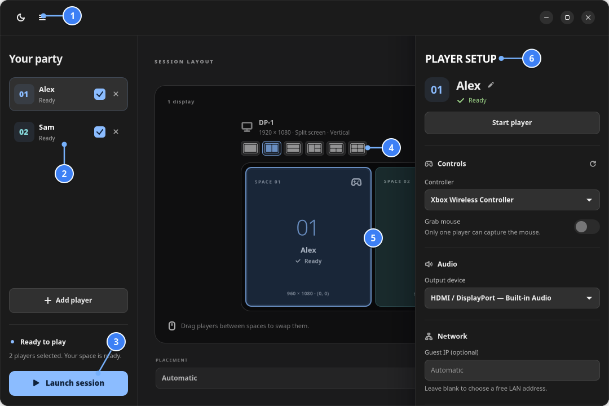
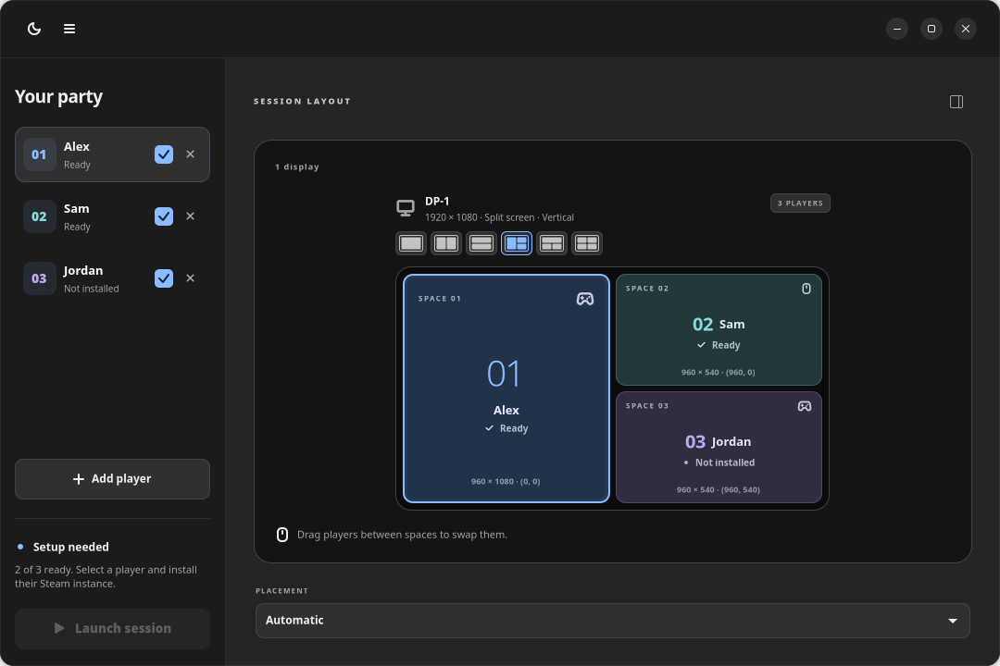
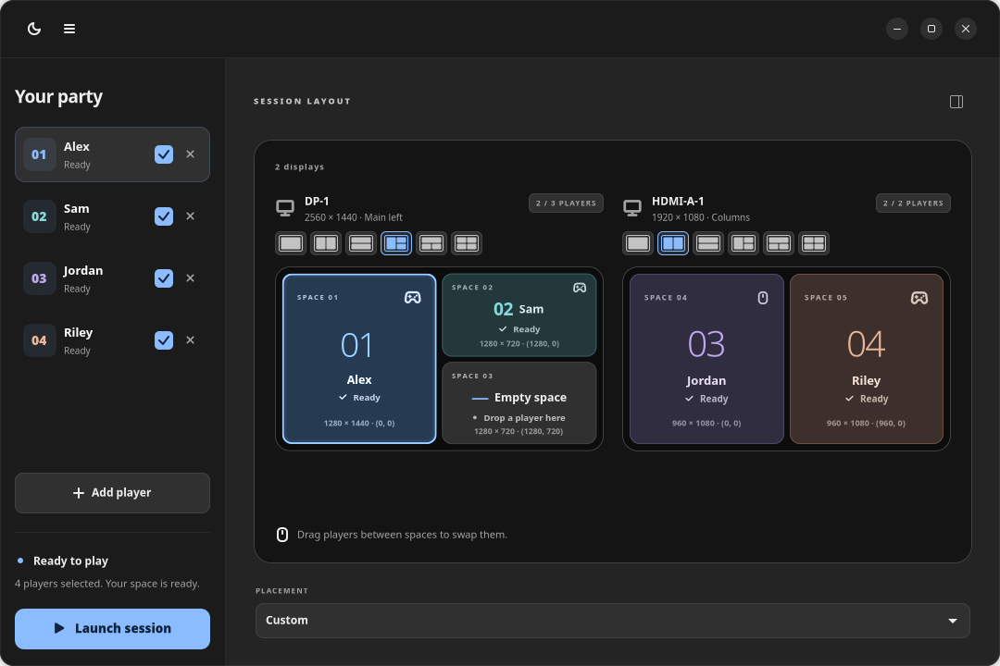
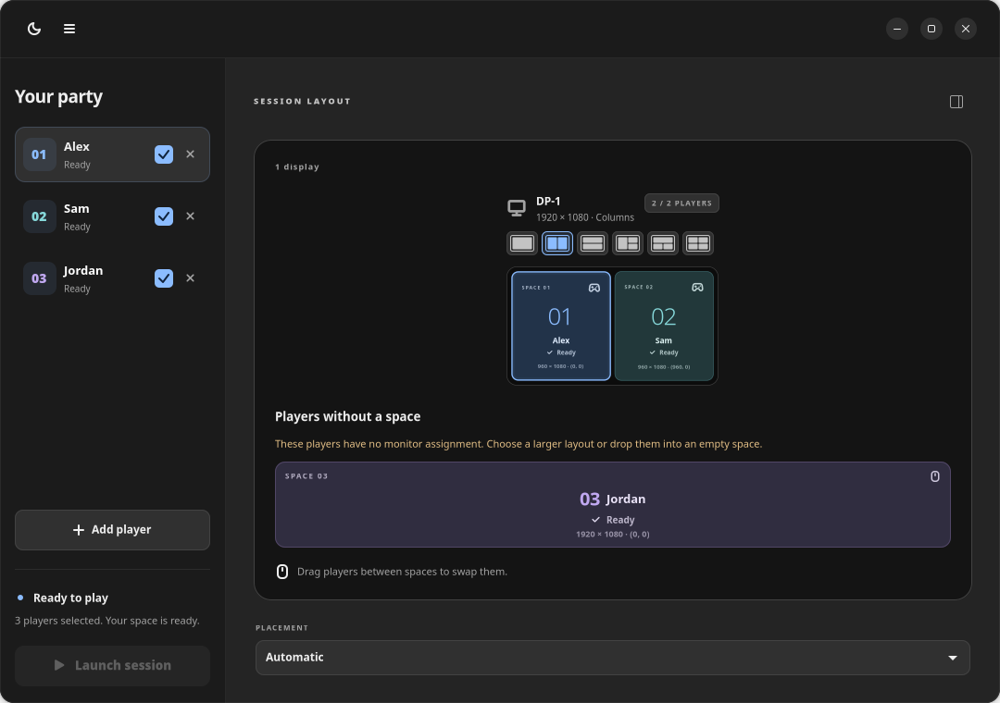
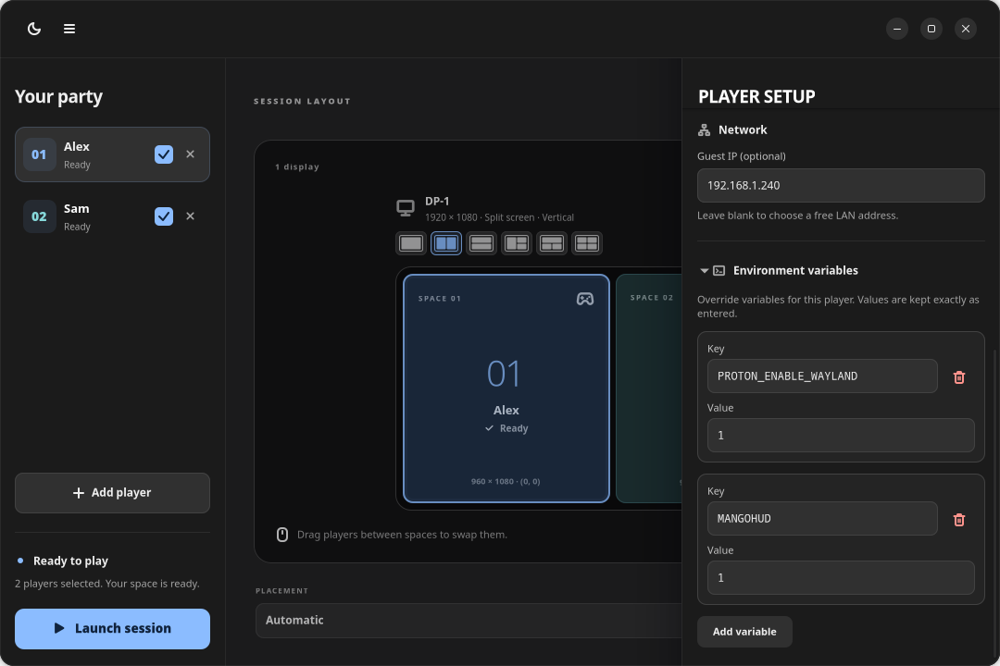
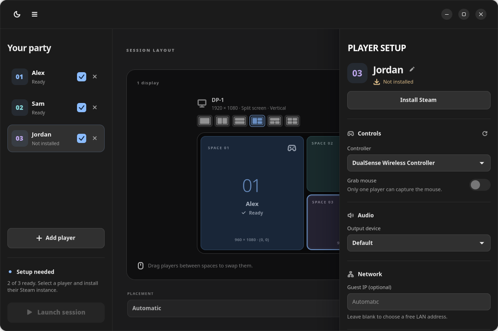
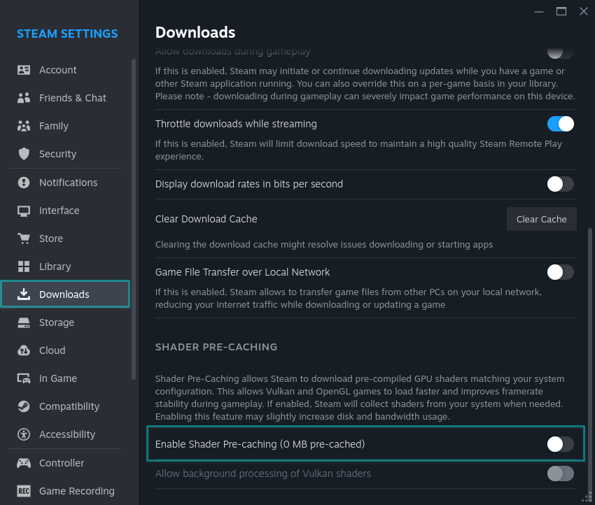
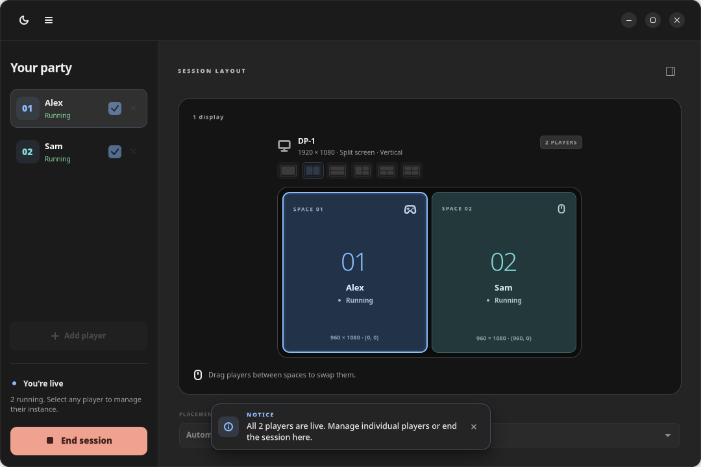
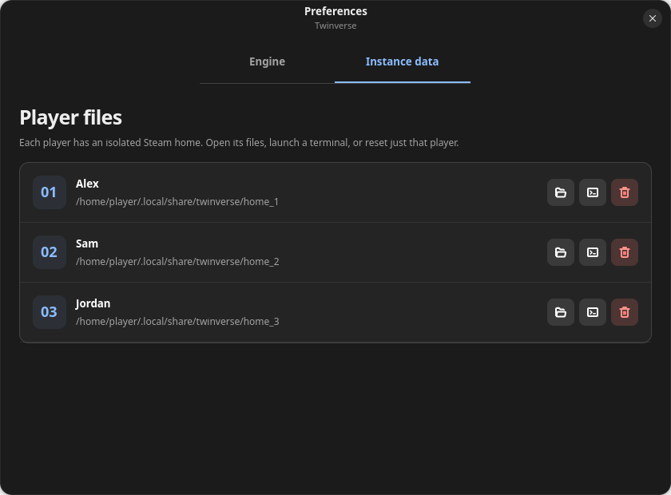

<p align="right">
  <a href="https://mall0r.github.io/Twinverse/"></a>
  <a href="GUIDE.md"></a>
  <a href="GUIDE.pt-br.md"></a>
</p>

# Twinverse Step-by-Step Guide

> [!TIP]
> Prefer a searchable, interactive version with dark/light theme and click-to-zoom screenshots? Open the [**Twinverse Documentation Site**](https://mall0r.github.io/Twinverse/).

Welcome to the Twinverse guide! Follow the five steps below to configure players, arrange monitor layouts, bind controllers and audio devices, sign into Steam, and launch a live multi-instance session.

## Prerequisites

> [!IMPORTANT]
> Add your user to the `input` group so Twinverse can access controllers and create automatic virtual joysticks, then **reboot your computer**:
>
> ```bash
> # Most Linux distributions
> sudo usermod -aG input "$USER"
>
> # Bazzite
> ujust add-user-to-input-group
> ```

Make sure native `steam`, `gamescope`, `bubblewrap` (`bwrap`), and `pactl` are installed on the host. Installing `pasta` (`passt` package) is strongly recommended for per-instance network isolation.

## Studio Overview



1. **Header Bar & Menu:** Toggle left/right panels, switch Dark/Light theme, open **Preferences** (`Ctrl+,`), or refresh devices (`F5`).
2. **Party Roster:** Add up to 8 players, toggle participation checkboxes, view readiness (`Ready` / `Not installed` / `Running`), or drag players onto spaces.
3. **Session Status & Launch Bar:** Shows live readiness and the **Launch session** / **End session** button (`Ctrl+Enter`).
4. **Placement & Tiling Picker:** Switch between `Automatic` and `Custom` placement and pick a tiling template independently for each monitor.
5. **Interactive Player Spaces:** True-aspect monitor preview displaying player names, status dots, controller badges (hover a gamepad icon to see the assigned controller name), and mouse-grab indicators.
6. **Player Setup Inspector:** Edit player names, install/start/stop individual instances, assign controller, `Grab mouse`, audio output, `Guest IP`, and environment variables.

---

## 1. Build Your Party (1–8 Players)

In the left-hand **Party** sidebar:

- Click **+ Add player** to add up to **8 players** (`home_1`–`home_8`).
- Use the **checkbox** next to each player to include or exclude them from the next session without deleting their settings.
- Click **×** to hide a player from the list while preserving their saved configuration and home folder (clicking **+ Add player** restores the lowest unused slot).
- Select any player to inspect them in **Player Setup** and click their name to rename them (up to 32 characters; `Enter` confirms, `Esc` cancels).



---

## 2. Configure Monitor Tiling & Placement

> [!NOTE]
> Automatic splitscreen and multi-monitor window tiling requires **KDE Plasma 6.0+**. On other desktop environments, Twinverse still sizes every Gamescope window accurately; simply position the windows manually.

Beneath every monitor heading in **Session Layout**, choose one of six independent tiling templates (saved per display connector such as `DP-1` or `HDMI-A-1`):

- **Fullscreen (1 space):** One full-monitor space.
- **Columns (2 spaces):** Side-by-side vertical split.
- **Rows (2 spaces):** Top-and-bottom horizontal split.
- **Main left (3 spaces):** Tall main space on the left + two stacked spaces on the right.
- **Main top (3 spaces):** Wide main space on top + two side-by-side spaces below.
- **Grid (4 spaces):** Four equal 2×2 quadrants.

You can mix templates across monitors (for example, `Main left` on Monitor 1 and `Columns` on Monitor 2).



### Drag-and-Drop Placement & Overflow Protection

- **Drag & drop:** Drag any player tile on the canvas (or any row from the Party Roster) onto another empty or occupied space—even on a different monitor. Occupied spaces swap players smoothly. Hold near the top or bottom edge to auto-scroll tall multi-monitor layouts.
- **Automatic vs. Custom:** Your first manual drag switches **Placement** to **Custom**. Select **Automatic** to restore numerical order without changing your monitor templates.
- **Players without a space:** If your templates have fewer spaces than checked players, extra players appear under **Players without a space**, and launching is blocked until you choose a larger template, drag them into an empty space, or exclude them.



---

## 3. Configure Each Player (Player Setup)

Select each player to configure their dedicated hardware in the right-hand **Player Setup** panel (toggle anytime with `F9` or `Alt+2`):

- **Controller:** Searchable dropdown of connected gamepads (`/dev/input/by-id/*-event-joystick`) with smooth marquee scrolling for long device names, full-name tooltips, and a selection dot marking the active controller. Press `F5` (or click Refresh) after plugging in new controllers. Leave as `None` to let Twinverse create an automatic `"Virtual Joystick by Twinverse"` during launch. Physical controllers automatically reconnect if unplugged or replugged mid-session.
- **Grab mouse:** Passes `--force-grab-cursor` to Gamescope. Only one player at a time can grab the mouse and keyboard; enabling it disables it on other players.
- **Audio output:** Searchable list of PipeWire/PulseAudio sinks (`Default` or dedicated `PULSE_SINK`).
- **Guest IP:** Optional fixed IPv4/CIDR when using `pasta`. Leave empty (`Automatic`) to auto-assign a free LAN IPv4. Automatically disabled (while preserving any saved IP) if **Isolate network** is turned off in `Preferences -> Engine`.
- **Environment variables:** Expand and click **Add variable** to set per-player `bwrap` environment variables (e.g., `PROTON_ENABLE_WAYLAND=1`, `MANGOHUD=1`).



---

## 4. Install Steam & Sign In (First Time Per Player)

New slots start as `Not installed`. Initialize Steam once per player:

1. Select an unverified player and click **Install Steam** in Player Setup. Steam opens directly inside Bubblewrap (without Gamescope) for easy desktop login.
2. Wait for Steam to initialize the isolated home folder, then sign into that player's Steam account. Host games from `~/.local/share/Steam/steamapps/common/` appear automatically.
3. **(Recommended)** In Steam, go to `Settings > Downloads` and disable **Enable Shader Pre-Caching** to save disk space and prevent duplicate shader downloads across instances.
4. Close the Steam window. Twinverse verifies the slot and changes its status to `Ready`.





> [!TIP]
> You can click **Start player** anytime on a `Ready` player to open that single Steam instance in desktop mode without Gamescope.

---

## 5. Launch Session & Play

Once all participating players show `Ready` and fit inside your monitor layout, click **Launch session** (or press `Ctrl+Enter`).

- Twinverse prepares KWin tiling and sets KDE panels to `dodgewindows` (on KDE Plasma 6.0+).
- Players start sequentially (5-second stagger) while Twinverse displays a live single-line Steam startup log in Player Setup and tracks `steamwebhelper` readiness.
- When all players are live, Twinverse minimizes automatically. Return anytime to stop an individual player (**Stop player**) or click **End session** to shut everything down cleanly and restore KDE panels.



---

## Features & Tips

### Per-Instance Networking (`pasta`)

If Steam Link or multiplayer games experience port conflicts or slow Steam relays (especially when hosting a game server on the same PC), install `pasta` (usually the `passt` package) on your host—including when using Twinverse via Flatpak—and relaunch.

Twinverse detects `pasta` automatically and gives each instance its own rootless network namespace and free LAN IPv4 address. Set **Guest IP** in Player Setup only if you need a fixed address; keep addresses distinct and unused on your LAN. Without `pasta`, Twinverse transparently falls back to shared host networking.

If you want instances to share the host network (for LAN discovery or local P2P, even with `pasta` installed), toggle **Isolate network** off under `Preferences -> Engine`. Any saved `Guest IP` values are preserved and re-enabled when you turn isolation back on.

### Preferences & Instance Data (`Ctrl+,`)

- **Engine tab:** Toggle **Use Gamescope** (off switches to Direct Steam mode), **Steam Deck tag** (`--mangoapp` + `-steamdeck` + FPS limiter), **Gamescope WSI** (`ENABLE_GAMESCOPE_WSI`), **Isolate network** (toggles `pasta` per-instance network namespaces), or **Reset all settings** (keeps disk homes).
- **Instance data tab:** Open any player's home folder (`home_1`–`home_8`), launch an interactive **sandboxed terminal** inside that player's `bwrap` (+ `pasta` when network isolation is enabled) + `PULSE_SINK` container, or permanently **Reset player**.



### Multi-GPU Support

To run a game on a secondary GPU, add `DRI_PRIME` to the **game's Steam Launch Options** inside that player's Steam client:

```bash
DRI_PRIME=1 %command%
# Or force selection:
DRI_PRIME=1! %command%
```

> [!WARNING]
> Add this to the **game's Steam Launch Options**, not Twinverse's Player Setup `Environment variables`, so Gamescope remains on the display-connected GPU.

### Steam Input & Controller Hotplug

Twinverse ships a pure-Rust userspace input virtualization layer (`libtwinverse_uinput.so` and `libtwinverse_udev.so`) together with the host-side `twinverse-input-bridge` supervisor:

- **Full Steam Input support (enabled by default):** Virtual controllers created by Steam Input stay strictly scoped to each player's private Unix sockets under `~/.tw-in/sock/`, never touching the host kernel's `/dev/uinput` and never leaking to other instances.
- **Automatic mid-session reconnection:** If a player's controller disconnects (dead battery, loose cable, or Bluetooth sleep), `twinverse-input-bridge` sends neutralizer events so sticks/buttons don't get stuck and seamlessly reconnects the controller when it comes back—including identical sibling controllers.
- **Dynamic `/dev/hidraw*` isolation:** Only the player's own controller `hidraw` nodes are exposed inside their sandbox (preserving native gyro, rumble, touchpad, and LEDs) without leaking other players' devices.
- **Graceful fallback:** Only when running from source without the native Rust libraries compiled does Twinverse fall back to static `/dev/input/eventX` bind-mounts and one-time per-account Steam Input disabling in `localconfig.vdf`.

### Keyboard Shortcuts

**Twinverse Studio:**
- `Ctrl + Enter` — Launch session / End session
- `Ctrl + ,` — Open Preferences
- `F9` or `Alt + 2` — Toggle Player Setup panel
- `F5` — Refresh controllers and audio devices
- `Enter` / `Esc` — Commit / cancel inline player rename

**Gamescope:**
- `Super + F` — Toggle fullscreen
- `Super + N` — Toggle nearest-neighbor filtering
- `Super + U` — Toggle FSR upscaling
- `Super + Y` — Toggle NIS upscaling
- `Super + I` / `Super + O` — Increase / decrease FSR sharpness
- `Super + S` — Take screenshot
- `Super + G` — Toggle keyboard grab

### Debugging & Logs

Run `twinverse --diagnostics` for a full environment summary, or see [DEBUGGING.md](DEBUGGING.md) for CLI flags, log locations, native virtual uinput troubleshooting, and environment variables.
