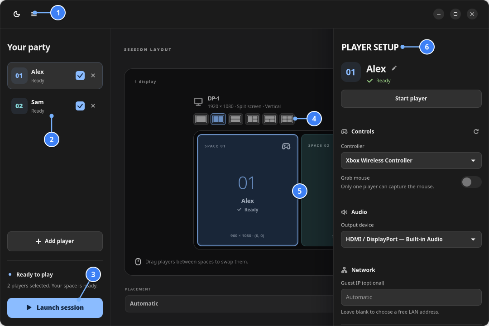
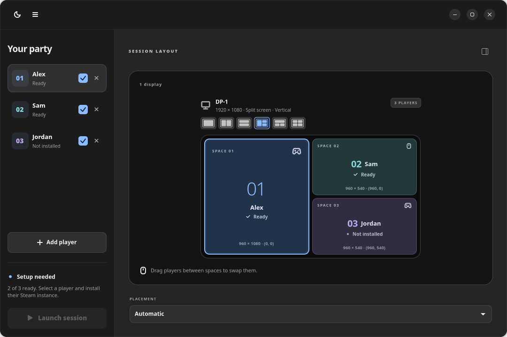
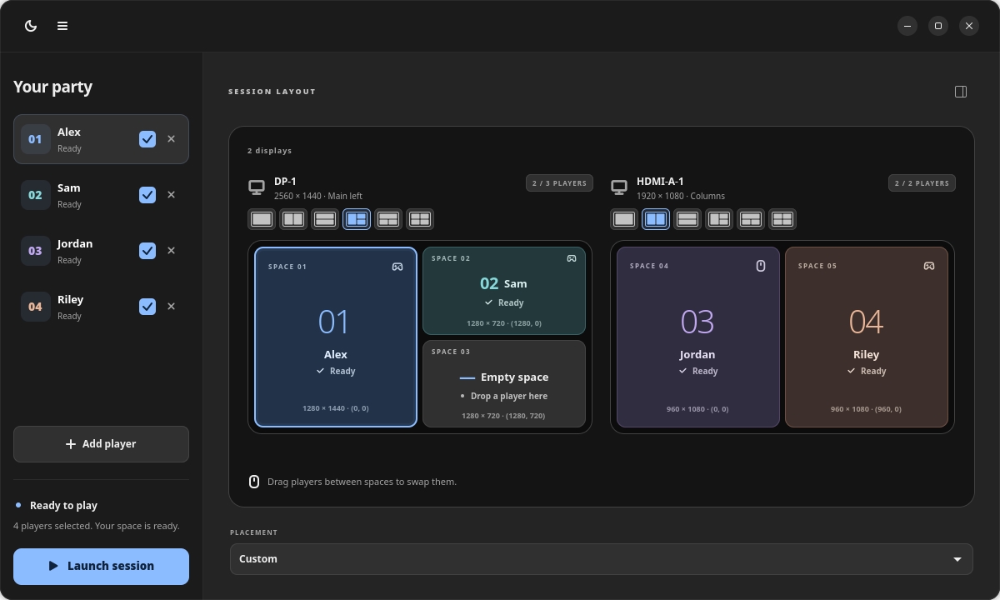
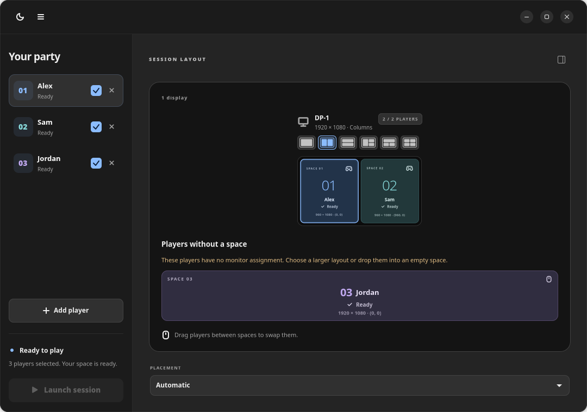
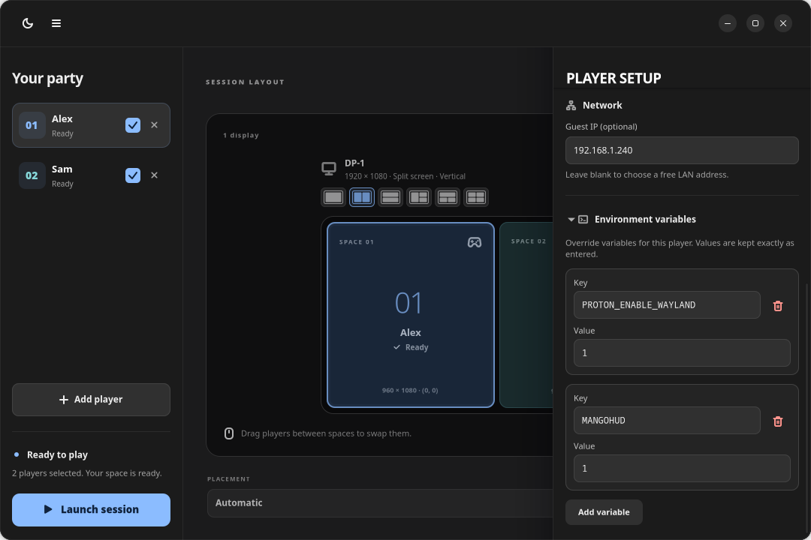
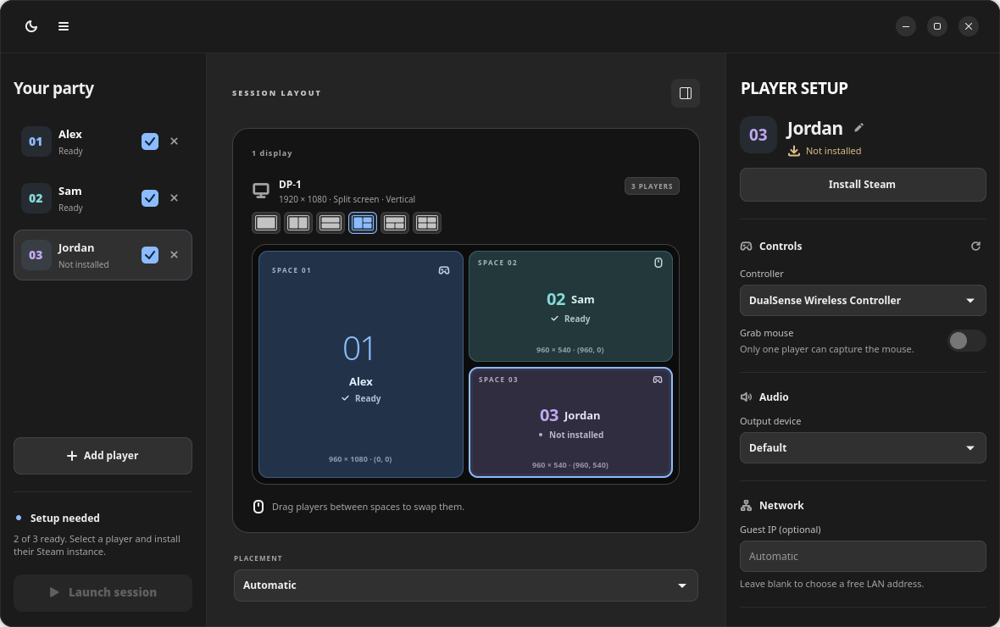
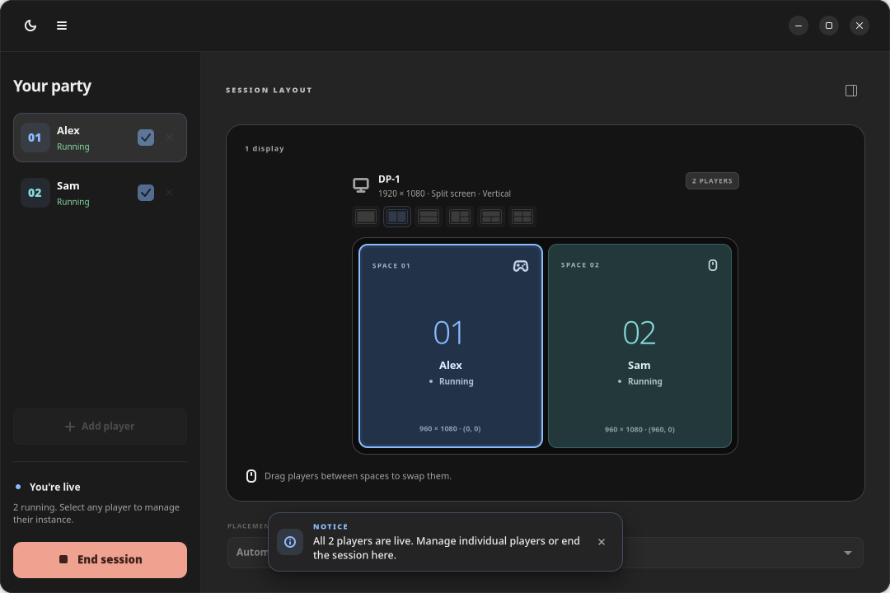
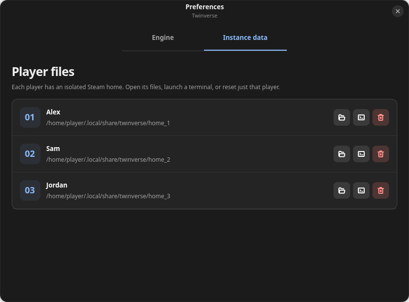

<p align="right">
  <a href="https://mall0r.github.io/Twinverse/?lang=pt"></a>
  <a href="GUIDE.md"></a>
  <a href="GUIDE.pt-br.md"></a>
</p>

# Guia Passo a Passo do Twinverse

> [!TIP]
> Prefere uma versão interativa com busca instantânea, tema claro/escuro e zoom nas imagens? Acesse o [**Site de Documentação do Twinverse**](https://mall0r.github.io/Twinverse/?lang=pt).

Bem-vindo ao guia do Twinverse! Siga os cinco passos abaixo para montar seu grupo, configurar o layout dos monitores, atribuir controles e saídas de áudio, entrar no Steam e iniciar uma sessão multi-instância.

## Pré-requisitos

> [!IMPORTANT]
> Adicione seu usuário ao grupo `input` para que o Twinverse consiga gerenciar controles e criar joysticks virtuais automáticos e, em seguida, **reinicie o computador**:
>
> ```bash
> # Maioria das distribuições Linux
> sudo usermod -aG input "$USER"
>
> # Bazzite
> ujust add-user-to-input-group
> ```

Certifique-se de ter os pacotes nativos `steam`, `gamescope`, `bubblewrap` (`bwrap`) e `pactl` instalados no host. Instalar `pasta` (pacote `passt`) é altamente recomendado para isolamento de rede por instância.

## Visão Geral do Studio



1. **Cabeçalho e Menu:** Alterna os painéis laterais, alterna tema Claro/Escuro, abre **Preferences** (`Ctrl+,`) ou atualiza dispositivos (`F5`).
2. **Lista de Jogadores (Party):** Adicione até 8 jogadores, marque quem participa, acompanhe o status (`Ready` / `Not installed` / `Running`) ou arraste jogadores para os espaços.
3. **Status da Sessão e Botão Iniciar:** Exibe a prontidão geral e o botão **Launch session** / **End session** (`Ctrl+Enter`).
4. **Posicionamento e Seletor de Moldes:** Alterna entre `Automatic` e `Custom` e permite escolher um molde visual independente para cada monitor.
5. **Espaços Interativos de Jogadores:** Pré-visualização proporcional de cada monitor com nome, indicador de status, selos de controle (passe o mouse sobre o ícone do controle para ver o nome completo atribuído) e indicador de mouse.
6. **Inspetor Player Setup:** Permite renomear o jogador, instalar/iniciar/parar a instância individualmente e configurar controle, `Grab mouse`, saída de áudio, `Guest IP` e variáveis de ambiente.

---

## 1. Monte o Grupo (1–8 Jogadores)

Na barra lateral esquerda **Party**:

- Clique em **+ Add player** para adicionar até **8 jogadores** (`home_1`–`home_8`).
- Use a **caixa de seleção** de cada jogador para incluí-lo ou deixá-lo de fora da próxima sessão sem perder suas configurações.
- Clique em **×** para ocultar um jogador da lista preservando suas configurações e pasta home em disco (clicar em **+ Add player** depois restaura o menor slot livre).
- Selecione qualquer jogador para abrir o **Player Setup** e clique no nome para renomeá-lo (até 32 caracteres; `Enter` confirma, `Esc` cancela).



---

## 2. Configure os Moldes e o Posicionamento

> [!NOTE]
> O posicionamento automático (auto-tiling) em tela dividida e múltiplos monitores requer **KDE Plasma 6.0+**. Em outros ambientes de desktop, o Twinverse continua dimensionando cada janela do Gamescope com precisão; basta posicionar as janelas manualmente.

Abaixo do título de cada monitor em **Session Layout**, escolha um dos seis moldes independentes (salvos por conector, como `DP-1` ou `HDMI-A-1`):

- **Fullscreen (1 espaço):** Um espaço ocupando o monitor inteiro.
- **Columns (2 espaços):** Divisão vertical lado a lado.
- **Rows (2 espaços):** Divisão horizontal empilhada.
- **Main left (3 espaços):** Espaço principal à esquerda + dois empilhados à direita.
- **Main top (3 espaços):** Espaço principal largo no topo + dois lado a lado abaixo.
- **Grid (4 espaços):** Quatro quadrantes iguais (2×2).

Você pode combinar moldes diferentes entre monitores (por exemplo, `Main left` no Monitor 1 e `Columns` no Monitor 2).



### Arrastar-e-Soltar e Proteção de Excedentes

- **Arrastar e soltar:** Arraste qualquer bloco no canvas (ou uma linha da lista Party) para um espaço vazio ou ocupado—inclusive em outro monitor. Espaços ocupados trocam de jogador suavemente. Segure perto das bordas superior/inferior para rolar automaticamente.
- **Automatic vs. Custom:** O primeiro arraste manual muda **Placement** para **Custom**. Escolha **Automatic** para restaurar a ordem numérica mantendo os moldes escolhidos.
- **Players without a space:** Se os moldes tiverem menos espaços do que jogadores marcados, os excedentes aparecem em **Players without a space** e o início da sessão fica bloqueado até você escolher um molde maior, arrastá-los para um espaço livre ou desmarcá-los.



---

## 3. Configure Cada Jogador (Player Setup)

Selecione cada jogador para configurar seu hardware no painel direito **Player Setup** (alterne a qualquer momento com `F9` ou `Alt+2`):

- **Controller:** Menu pesquisável com os controles conectados (`/dev/input/by-id/*-event-joystick`), com rolagem suave (marquee) para nomes longos, tooltip com o nome completo e um ponto indicador no item selecionado. Pressione `F5` (ou clique em atualizar) após conectar novos controles. Deixe em `None` para que o Twinverse crie automaticamente um `"Virtual Joystick by Twinverse"` ao iniciar a sessão. Controles físicos se reconectam automaticamente se forem desconectados e reconectados no meio da partida.
- **Grab mouse:** Passa `--force-grab-cursor` ao Gamescope. Apenas um jogador por vez pode capturar mouse e teclado; ativar em um desativa nos demais.
- **Audio output:** Lista pesquisável de saídas PipeWire/PulseAudio (`Default` ou `PULSE_SINK` dedicado).
- **Guest IP:** IPv4/CIDR fixo opcional ao usar `pasta`. Deixe vazio (`Automatic`) para escolha automática de um IPv4 livre na LAN. Fica desabilitado automaticamente (preservando o IP salvo) quando **Isolate network** está desligado em `Preferences -> Engine`.
- **Environment variables:** Expanda e clique em **Add variable** para injetar variáveis de ambiente individuais no `bwrap` (ex.: `PROTON_ENABLE_WAYLAND=1`, `MANGOHUD=1`).



---

## 4. Instale o Steam e Faça Login (Primeira Vez por Jogador)

Slots novos aparecem como `Not installed`. Inicialize o Steam uma vez por jogador:

1. Selecione um jogador não verificado e clique em **Install Steam** no Player Setup. O Steam abre diretamente no Bubblewrap (sem Gamescope) para facilitar o login em modo desktop.
2. Aguarde o Steam preparar a pasta home isolada e entre na conta Steam desse jogador. Os jogos já instalados em `~/.local/share/Steam/steamapps/common/` aparecem automaticamente.
3. **(Recomendado)** No Steam, vá em `Configurações > Downloads` e desative **Ativar download prévio de sombreadores** para economizar espaço em disco e evitar downloads duplicados.
4. Feche a janela do Steam. O Twinverse verifica a instalação automaticamente e muda o status para `Ready`.




> [!TIP]
> Você pode clicar em **Start player** a qualquer momento em um jogador `Ready` para abrir aquela instância individual em modo desktop sem Gamescope.

---

## 5. Inicie a Sessão e Jogue

Quando todos os jogadores marcados estiverem `Ready` e alocados no layout, clique em **Launch session** (ou pressione `Ctrl+Enter`).

- O Twinverse prepara o script de layout do KWin e coloca os painéis do KDE em `dodgewindows` (no KDE Plasma 6.0+).
- Os jogadores iniciam sequencialmente (intervalo de 5 segundos) enquanto o Twinverse exibe uma linha de log do Steam em tempo real no Player Setup e acompanha o carregamento do `steamwebhelper`.
- Quando todos estiverem prontos, o Twinverse se minimiza automaticamente. Volte quando quiser para encerrar um jogador individual (**Stop player**) ou clique em **End session** para encerrar tudo com segurança e restaurar os painéis do KDE.



---

## Funcionalidades e Dicas

### Rede por Instância (`pasta`)

Se o Steam Link ou jogos multiplayer tiverem problemas de conexão, conflitos de porta ou relays lentos do Steam (especialmente ao rodar um servidor dedicado no mesmo PC), instale o `pasta` (geralmente pacote `passt`) no host—inclusive ao usar o Twinverse via Flatpak—e reinicie a sessão.

O Twinverse detecta o `pasta` automaticamente e atribui a cada instância um namespace de rede sem root com um endereço IPv4 livre na LAN. Preencha **Guest IP** no Player Setup apenas se precisar de um endereço fixo; use IPs livres e diferentes entre si. Sem o `pasta`, o Twinverse continua usando a rede compartilhada do host.

Se quiser que as instâncias compartilhem a rede do host (para descoberta LAN ou P2P local, mesmo com `pasta` instalado), desative **Isolate network** em `Preferences -> Engine`. Quaisquer valores salvos em `Guest IP` são preservados e voltam a ficar ativos quando você religar o isolamento.

### Preferências e Dados das Instâncias (`Ctrl+,`)

- **Aba Engine:** Alterna **Use Gamescope** (desativado entra em Direct Steam mode), **Steam Deck tag** (`--mangoapp` + `-steamdeck` + limitador de FPS), **Gamescope WSI** (`ENABLE_GAMESCOPE_WSI`), **Isolate network** (ativa ou desativa namespaces de rede do `pasta`) ou **Reset all settings** (mantém as pastas home em disco).
- **Aba Instance data:** Abre a pasta home de cada jogador (`home_1`–`home_8`), inicia um **terminal dentro da sandbox** (`bwrap` + `pasta` quando o isolamento de rede está ativo + `PULSE_SINK`) do jogador ou executa **Reset player** permanentemente.



### Suporte a Múltiplas GPUs

Para rodar um jogo em uma GPU secundária, adicione `DRI_PRIME` às **Opções de Inicialização do jogo no Steam** dentro da instância Steam do jogador:

```bash
DRI_PRIME=1 %command%
# Ou force a seleção:
DRI_PRIME=1! %command%
```

> [!WARNING]
> Adicione isso nas **Opções de Inicialização do jogo no Steam**, e não nas `Environment variables` do Player Setup, para que o Gamescope continue na GPU principal.

### Steam Input e Hotplug de Controles

O Twinverse inclui uma camada de virtualização de entrada em espaço de usuário feita em Rust puro (`libtwinverse_uinput.so` e `libtwinverse_udev.so`) junto do supervisor de host `twinverse-input-bridge`:

- **Suporte completo ao Steam Input (ativo por padrão):** Controles virtuais criados pelo Steam Input ficam estritamente restritos aos sockets Unix privados de cada jogador em `~/.tw-in/sock/`, sem tocar no `/dev/uinput` do host e sem vazar para outras instâncias.
- **Reconexão automática no meio da sessão:** Se o controle de um jogador desconectar (bateria fraca, cabo solto ou suspensão Bluetooth), o `twinverse-input-bridge` envia eventos de neutralização para evitar botões/analógicos presos e reconecta o controle automaticamente quando ele voltar—incluindo controles idênticos.
- **Isolamento dinâmico de `/dev/hidraw*`:** Apenas os nós `hidraw` pertencentes ao controle daquele jogador ficam visíveis na sandbox (preservando giroscópio, vibração, touchpad e LEDs nativos), sem expor os controles dos demais jogadores.
- **Modo de fallback:** Somente ao executar a partir do código-fonte sem as bibliotecas nativas em Rust compiladas o Twinverse recorre aos bind-mounts estáticos de `/dev/input/eventX` e à máscara estática de `/dev/hidraw*`.

### Atalhos de Teclado

**Twinverse Studio:**
- `Ctrl + Enter` — Iniciar sessão / Encerrar sessão
- `Ctrl + ,` — Abrir Preferências
- `F9` ou `Alt + 2` — Abrir/fechar painel Player Setup
- `F5` — Atualizar controles e dispositivos de áudio
- `Enter` / `Esc` — Confirmar / cancelar renomeação do jogador

**Gamescope:**
- `Super + F` — Alternar tela cheia
- `Super + N` — Alternar filtragem por vizinho mais próximo
- `Super + U` — Alternar upscaling FSR
- `Super + Y` — Alternar upscaling NIS
- `Super + I` / `Super + O` — Aumentar / diminuir nitidez FSR
- `Super + S` — Capturar tela
- `Super + G` — Alternar captura do teclado

### Depuração e Logs

Execute `twinverse --diagnostics` para um relatório completo do ambiente ou consulte [DEBUGGING.pt-br.md](DEBUGGING.pt-br.md) para flags CLI, caminhos de logs, diagnóstico de uinput virtual e variáveis de ambiente.
