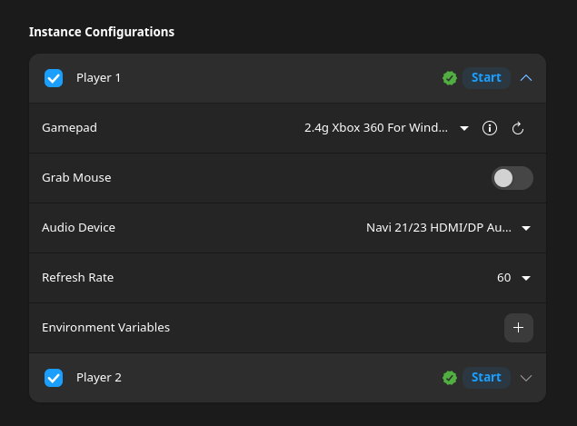
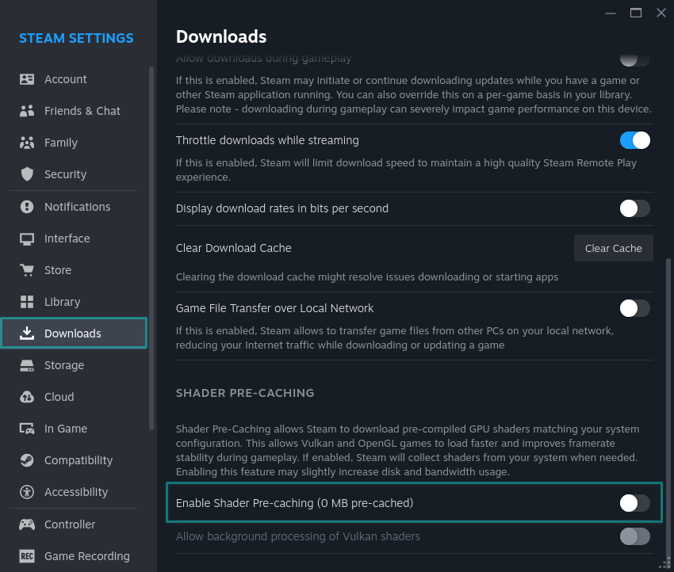

<p align="right">
  <a href="https://github.com/mall0r/Twinverse/blob/main/docs/GUIDE.md"></a>
  <a href="https://github.com/mall0r/Twinverse/blob/main/docs/GUIDE.pt-br.md"></a>
</p>

# Guia do Twinverse

Bem-vindo ao guia do Twinverse! Este documento irá guiá-lo pelo processo de configuração e uso do aplicativo Twinverse.

### Problemas de conexão

Se o Steam Link ou jogos apresentarem problemas de conexão causados por várias instâncias usando as mesmas portas, instale o `pasta` no sistema (geralmente pelo pacote `passt`) e reabra as instâncias. O Twinverse o detecta automaticamente e isola a rede de cada instância mantendo o acesso à internet, sem executar como root. Isso também vale para a versão Flatpak: o `pasta` precisa estar disponível no `PATH` do host.

Cada instância também recebe um endereço IPv4 livre na sub-rede do host. Isso importa quando o servidor do jogo roda na mesma máquina dos clientes: sem um endereço distinto, o guest e o servidor compartilham o endereço do host e o Steam pode encaminhar a conexão por um relay, aumentando a latência. O Twinverse escolhe um endereço livre automaticamente e nunca usa o endereço do host. Se precisar de um endereço fixo, preencha o campo "Guest IP" da instância; deixe-o vazio para manter a escolha automática. Use endereços livres na sua rede e mantenha-os diferentes entre as instâncias.

Sem o `pasta`, a rede funciona como antes, compartilhando a rede do host entre as instâncias.

## 1. Número de Instâncias

Primeiro, você precisa decidir quantas instâncias do Steam deseja executar. O Twinverse suporta até 8 instâncias no total.

- **Tela Dividida (Splitscreen):** Você pode executar no máximo 4 instâncias por monitor.
- **Tela Cheia (Fullscreen):** Cada instância é executada em um monitor separado.

Use **Party size**, na lateral esquerda, para definir a quantidade e marque os jogadores que vão participar. O botão **Launch session** fica no rodapé dessa lateral. Os controles de abrir e fechar os painéis ficam junto ao menu do aplicativo, à esquerda do cabeçalho.


## 2. Modo de Tela

> [!NOTE]
> Para que o auto-tiling das janelas funcione bem, é recomendado usar KDE Plasma 6.0+.
> Em outras DE, será necessário mover as janelas você mesmo, todo o resto deve funcionar bem.

Escolha um molde pelos seis ícones de layout abaixo do título de cada monitor. A escolha é independente por monitor:

- **Fullscreen:** um espaço ocupando o monitor inteiro.
- **Columns / Rows:** dois espaços, lado a lado ou empilhados.
- **Main left / Main top:** três espaços, com uma área principal maior à esquerda ou no topo.
- **Grid:** quatro espaços iguais.

Você pode combinar moldes: por exemplo, dois jogadores em colunas no Monitor 1 e um jogador em tela cheia no Monitor 2. O canvas mostra os espaços exatos; ao passar o ponteiro sobre um ícone, aparecem seu nome e sua capacidade. Monitores ainda não utilizados também têm seu próprio seletor.

Espaços vazios ficam disponíveis para arrastar jogadores ou escolher pelo Player Setup. Se os moldes não comportarem todos os participantes, os excedentes aparecem em **Players without a space**. O início da sessão fica bloqueado até você escolher um molde maior ou desmarcar esses jogadores.

Os moldes e as posições são salvos por conector de monitor. Eles determinam as dimensões e a taxa de atualização do Gamescope e o posicionamento das janelas no KWin. Perfis existentes mantêm a disposição anterior até você escolher um molde.

#### Posicionamento das Instâncias

Por padrão, as instâncias ocupam o layout em ordem numérica. Você pode mudar a posição de um jogador de duas formas:

- **Arrastar e soltar:** arraste o jogador da lateral ou de um espaço do canvas até outro espaço, inclusive em outro monitor. Mantenha o ponteiro próximo à borda superior ou inferior do canvas para rolar uma disposição com vários monitores.
- **Player Setup:** selecione o jogador e escolha **Monitor / space** na seção **Display position**. A lista de destinos corresponde aos espaços mostrados no canvas.

Espaços ocupados trocam seus jogadores, sem duplicar ou perder participantes. A primeira alteração ativa **Custom** em **Placement** automaticamente. Escolha **Automatic** para restaurar a ordem numérica sem alterar os moldes dos monitores. O arraste e a seleção ficam sincronizados e são bloqueados enquanto alguma instância inicia, está em execução ou encerra. A ordem salva é usada nas dimensões do Gamescope e no posicionamento do KWin.

O posicionamento é aplicado no próximo lançamento. Ao reduzir o número de instâncias, as posições salvas ficam ocultas e voltam se você aumentar a quantidade novamente.

## 3. Configuração da Instância

> [!IMPORTANT]
> Para usar o Twinverse, é necessário adicionar seu usuário ao grupo `input` para permitir que o programa gerencie os dispositivos de entrada.
>
> ```bash
> sudo usermod -aG input $USER
> ```
> no Bazzite:
> ```bash
> ujust add-user-to-input-group
> ```
> **Reinicie o sistema para que as alterações entrem em vigor.**

Para cada instância, você pode configurar as seguintes opções:

- **Controle (Gamepad):** Atribuir um controle específico à instância.
- **Grab Mouse:** Dedicar o mouse a uma única instância. Por enquanto, apenas uma instância por vez pode usar o mouse e o teclado.
- **Dispositivo de Áudio:** Selecionar um dispositivo de saída de áudio específico para a instância.
- **Variável de Ambiente (Environment Variables):** Definir variáveis de ambiente específicas para a instância.



## 4. Iniciando uma Instância

Após configurar uma instância, clique no botão **"Start"** ao lado dela para iniciar uma instância Steam no modo desktop. Na primeira vez, o Cliente Steam será baixado e instalado automaticamente — esse processo pode levar alguns minutos.

Você deve fazer login no modo desktop. Após logar e configurar seu Cliente Steam basta encerrar a instância.

o Botão **"Play"**, executa todas as instâncias marcadas e com um check, ele vai executar todas com o gamescope e vai redimensionar cada uma.
Se você estiver usando KDE Plasma, tambem vai move-las automaticamente para dividir a tela idealmente pra seu monitor principal, ou move-las entre seu monitores caso tenha selecionado fullscreen.

Apenas instâncias que já possuem o Steam instalado podem ser iniciadas com o **"Play"**. Você pode verificar isso pelo ícone de check  na instância. Se o ícone for um , instale o Steam clicando no botão **"Install"** daquela instância.


## 5. Desabilitar Download Prévio de Sombreadores (Opicional)

Para meconomizar espaço em disco, desabilite o download prévio de sombreadores no Steam. Tambem recomendo fazer isso caso tenha qualquer problema com o Download de Shaders Pre-Caching.

Para fazer isso, vá em `Configurações > Downloads` e desabilita a opção `Ativar download prévio de sombreadores`.



## 6. Jogar

Quando todas as suas instâncias estiverem configuradas e em execução, você pode começar a jogar! Cada instância terá seus próprios dispositivos de entrada e áudio dedicados, permitindo que você jogue com seus amigos ou familiares no mesmo computador.

Divirta-se em sua sessão de jogos!


# Dicas

## 1. Suporte a Multiplas GPUs

O Twinverse funciona com jogos em diferentes GPUs.

Adicione a seguinte linha aos argumentos do Steam do seu jogo:

```bash
DRI_PRIME=1
```

Ou force com:

```bash
DRI_PRIME=1!
```

Você pode ajustar os numeros de acordo com a configuração do seu sistema.

> [!WARNING]
>
> Isso deve ser adicionado diretamente no argumento do jogo na instância Steam que deseja usar a GPU, não adicione isso ao `Enviroments Variables`.

## 2. Diretorios Home

Você pode excluir ou gerenciar os arquivos o diretorio home de cada instância, acessando `Preferences` -> `Instances`.


### 3. Steam Input

O Steam Input não é compatível com as instâncias, então o Twinverse desativa dentro de cada instância: na primeira inicialização que já encontra uma conta logada, ele desliga o botão de controle e todos os jogos da biblioteca da instância. Em uma instância nova isso acontece na inicialização logo após você fazer login.

Isso acontece apenas uma vez por instância. Qualquer coisa que você alterar depois é mantida, e o seu próprio Steam fora do Twinverse nunca é alterado.

### 4. Atalhos de teclado do Gamescope:
```
Super + F       Alternar tela cheia
```
```
Super + N       Alternar filtragem por vizinho mais próximo
```
```
Super + U       Alternar e aumentar a escala FSR
```
```
Super + Y       Alternar e aumentar a escala NIS
```
```
Super + I       Aumentar a nitidez FSR em 1
```
```
Super + O       Diminuir a nitidez FSR em 1
```
```
Super + S       Tirar uma captura de tela
```
```
Super + G       Alternar captura de tela com o teclado
```
