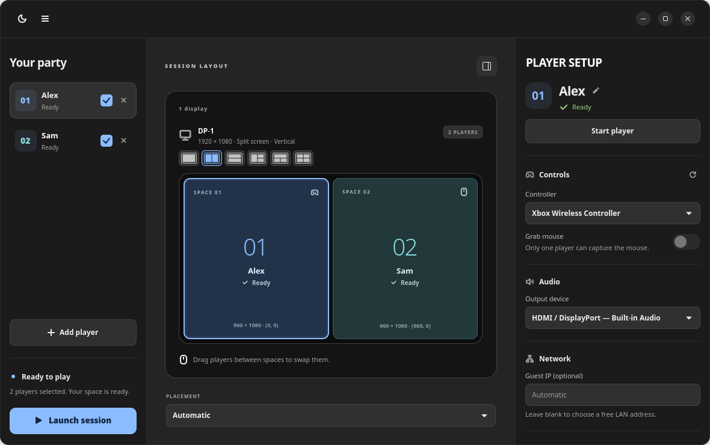

<p align="right">
  <a href="https://mall0r.github.io/Twinverse/?lang=pt"></a>
  <a href="../README.md"></a>
  <a href="README.pt-br.md"></a>
</p>

<p align="center">
  
</p>

<p align="center">
  <a href="https://github.com/mall0r/Twinverse/releases"></a>
  <a href="https://mall0r.github.io/Twinverse/?lang=pt"></a>
  <a href="../LICENSE"></a>
  <a href="https://www.gtk.org/"></a>
  <a href="https://gnome.pages.gitlab.gnome.org/libadwaita/"></a>
</p>

<p align="center">
  <a href="https://www.python.org" target="_blank" rel="noopener noreferrer"></a>
  <a href="https://www.gnu.org/software/bash/" target="_blank" rel="noopener noreferrer"></a>
  <a href="https://www.javascript.com/" target="_blank" rel="noopener noreferrer"></a>
  <a href="https://www.w3.org/Style/CSS/" target="_blank" rel="noopener noreferrer"></a>
</p>

# O que é o Twinverse?

O **Twinverse** é um aplicativo open-source para Linux e SteamOS que permite criar e gerenciar até **8 instâncias isoladas do `Steam Big Picture`** simultaneamente. Vários jogadores podem aproveitar suas bibliotecas de jogos em um único computador—em tela dividida ou em múltiplos monitores—com controles, saídas de áudio, diretórios home e endereços IPv4 privados na LAN dedicados.

> [!TIP]
> **Documentação Interativa Completa:** Acesse o [**Site de Documentação do Twinverse**](https://mall0r.github.io/Twinverse/?lang=pt) (Português BR & English) para ver o guia passo a passo ilustrado, diagramas de layout, todas as funcionalidades, atalhos e solução de problemas.

<p align="center">
  
</p>

> [!WARNING]
> Este projeto não apoia a pirataria; todos os jogadores devem possuir (ou ter acesso legítimo ao) jogo em suas bibliotecas Steam para poderem jogá-lo.

## ✨ Principais Funcionalidades

> [!NOTE]
> Mouse e teclado (`Grab mouse`) só podem ser atribuídos a uma instância por vez.

1. **Até 8 Instâncias Isoladas:** Execute múltiplos clientes Steam simultaneamente com nomes editáveis, controle de participação por jogador e recuperação automática de sessão em caso de fechamento inesperado.
2. **Moldes por Monitor e Arrastar-e-Soltar:** Escolha entre 6 moldes visuais independentes por monitor (`Fullscreen`, `Columns`, `Rows`, `Main left`, `Main top`, `Grid` — até 4 jogadores por monitor), combine moldes entre telas e arraste jogadores diretamente entre os espaços.
3. **Isolamento Real de Entrada:** Mascara `/dev/input` em cada sandbox para que cada jogador enxergue apenas seu próprio controle (ou um `"Virtual Joystick by Twinverse"` criado automaticamente), além da desativação única do Steam Input por conta.
4. **Canais de Áudio Dedicados:** Direcione o áudio de cada instância para sua própria saída PipeWire/PulseAudio (`PULSE_SINK`) com isolamento de captura PipeWire por instância.
5. **Rede Isolada sem Root (`pasta`):** Atribui automaticamente um endereço IPv4 livre na LAN por instância (ou um `Guest IP` fixo opcional), evitando conflitos de porta e relays do Steam em partidas locais.
6. **Diretórios Home Dedicados e Terminal na Sandbox:** Cada jogador possui uma pasta `home_1`–`home_8` isolada com atalhos para abrir a pasta, abrir um terminal interativo dentro da sandbox do jogador ou zerar o slot.
7. **Pasta de Jogos Compartilhada e Qualquer Proton:** Monta `steamapps/common/` do host (com sincronização automática de manifestos `.acf`) e `compatibilitytools.d/` (incluindo [ProtonGE](https://github.com/GloriousEggroll/proton-ge-custom)), evitando downloads duplicados.
8. **Jogue Jogos Diferentes ao Mesmo Tempo:** Cada instância é totalmente independente—os jogadores não precisam jogar o mesmo jogo.
9. **Auto-Tiling no KDE Plasma 6 / KWin:** Posicionamento automático sem bordas via resolvedor D-Bus (`TWINVERSE_KWIN_INSTANCE`) e ocultação automática dos painéis do Plasma, que são restaurados ao encerrar a sessão.

---

[1920x1080-RX_6600_XT-demo](https://github.com/user-attachments/assets/e0ca4937-fd38-48cf-b56c-1c825b047572)

---

## 📦 Requisitos

É necessário ter instalados os pacotes **nativos** da sua distribuição: `steam`, `gamescope`, `bubblewrap` (`bwrap`) e `pactl` (`pipewire-pulse` ou `pulseaudio-utils`).

- **Altamente recomendado (`pasta` / `passt`):** Ativa o isolamento de rede sem root por instância com endereços IPv4 distintos na LAN. Instale no `PATH` do host, inclusive ao usar o Twinverse via Flatpak. Consulte a [seção de Rede](https://mall0r.github.io/Twinverse/?lang=pt#feature-networking) ou o [Guia](GUIDE.pt-br.md#rede-por-instância-pasta).
- **Grupo `input` obrigatório:** Adicione seu usuário ao grupo `input` e reinicie o computador para permitir o gerenciamento de controles e joysticks virtuais:

```bash
# Maioria das distribuições Linux
sudo usermod -aG input "$USER"

# Bazzite
ujust add-user-to-input-group
```

Para o Gamescope funcionar corretamente, conforme sua GPU:

- **AMD:** Mesa 20.3 ou mais recente
- **Intel:** Mesa 21.2 ou mais recente
- **NVIDIA:** Drivers proprietários 515.43.04 ou mais recente, ou NVIDIA Open Kernel Module

> [!NOTE]
> *SteamOS* (AMD) e *Bazzite* já incluem Steam, Gamescope, Bubblewrap e PipeWire por padrão.

## 📦 Instalação

### Flatpak (Recomendado)

1. Baixe o arquivo `Twinverse-*.flatpak` mais recente em [**Releases**](https://github.com/mall0r/Twinverse/releases).
2. Configure o repositório Flathub (se ainda não tiver) e instale:

```bash
flatpak remote-add --user --if-not-exists flathub https://flathub.org/repo/flathub.flatpakrepo
flatpak install --user Twinverse-*.flatpak
```

### AppImage

> [!NOTE]
> Garanta que o pacote `bubblewrap` esteja instalado no sistema host.

1. Baixe o arquivo `Twinverse-*.AppImage` mais recente em [**Releases**](https://github.com/mall0r/Twinverse/releases).
2. Torne-o executável e inicie:

```bash
chmod +x Twinverse-*.AppImage
./Twinverse-*.AppImage
```

Para integração ao menu de aplicativos e atualizações fáceis, recomendamos usar o **[Gear Lever](https://github.com/mijorus/gearlever)**.

### Executando a Partir do Código-Fonte

```bash
git clone https://github.com/mall0r/Twinverse.git
cd Twinverse
./run.sh
```

## 📖 Documentação e Guias

- **Documentação Interativa (PT-BR / EN):** [https://mall0r.github.io/Twinverse/?lang=pt](https://mall0r.github.io/Twinverse/?lang=pt)
- **Guia Passo a Passo (Markdown):** [docs/GUIDE.pt-br.md](GUIDE.pt-br.md) | [docs/GUIDE.md](GUIDE.md)
- **Depuração e Logs:** [docs/DEBUGGING.pt-br.md](DEBUGGING.pt-br.md) | [docs/DEBUGGING.md](DEBUGGING.md)

---

## ⚙️ Como Funciona

O Twinverse monta dinamicamente uma pilha de isolamento sem root para cada jogador:

```text
[pasta (netns opcional)] -> bwrap (sandbox) -> gamescope (compositor) -> Steam Big Picture
```

1. **`pasta`** (quando instalado) cria um namespace de rede isolado com um endereço IPv4 livre na rede local.
2. **`bwrap` (Bubblewrap)** monta um diretório `home_N` dedicado, mascara `/dev/input` expondo apenas o controle do jogador, compartilha `steamapps/common/` e `compatibilitytools.d/`, e injeta `PULSE_SINK` e variáveis de ambiente personalizadas.
3. **`gamescope`** renderiza o Steam Big Picture exatamente na resolução e taxa de atualização do espaço escolhido, gerencia a captura exclusiva de mouse e trabalha em conjunto com o resolvedor D-Bus do KWin no KDE Plasma 6.0+ para posicionamento automático sem bordas.

---

## 🛠️ Para Desenvolvedores

Se deseja contribuir com o Twinverse, consulte [CONTRIBUTING.md](../CONTRIBUTING.md) para instruções de ambiente, fluxo de trabalho e padrões de código.

---

## 📜 Licença

Este projeto está licenciado sob a **Licença Pública Geral GNU v3.0 (GPL-3.0-or-later)**. Veja [LICENSE](../LICENSE) para detalhes.

> [!NOTE]
> ## Aviso Legal
>
> O Twinverse é um projeto independente de código aberto e não é afiliado, endossado ou oficialmente conectado à Valve Corporation ou ao Steam.
>
> Esta ferramenta atua como uma camada de orquestração que aproveita tecnologias de sandboxing para executar múltiplas instâncias isoladas do cliente oficial do Steam. O Twinverse **não modifica, aplica patches, faz engenharia reversa ou altera** quaisquer arquivos do Steam ou seu funcionamento normal. Todas as instâncias iniciadas por esta ferramenta são as versões oficiais e não modificadas fornecidas pela Valve.
>
> Os usuários são os únicos responsáveis por cumprir os termos do Acordo de Assinante do Steam.

---

## 🙏 Créditos

Este projeto foi inspirado pelo trabalho de:

- [NaviVani-dev](https://github.com/NaviVani-dev) e seu script [dualscope.sh](https://gist.github.com/NaviVani-dev/9a8a704a31313fd5ed5fa68babf7bc3a).
- [Tau5](https://github.com/Tau5) e seu projeto [Co-op-on-Linux](https://github.com/Tau5/Co-op-on-Linux).
- [wunnr](https://github.com/wunnr) e seu projeto [Partydeck](https://github.com/wunnr/partydeck) (recomendado caso você procure uma abordagem mais próxima ao [Nucleus Co-op](https://github.com/SplitScreen-Me/splitscreenme-nucleus)).
